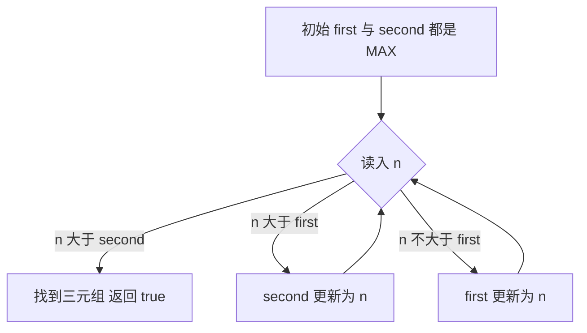

# 递增的三元子序列：解法分析笔记

> 题目内容：给定整数数组 `nums`，判断是否存在下标 `i < j < k`，使得 `nums[i] < nums[j] < nums[k]`。
> 题源：[LeetCode 334 - Increasing Triplet Subsequence](https://leetcode.cn/problems/increasing-triplet-subsequence/description/)
> 一句话概括：扫描时维护「最小头」和「最小尾」，当前值大于最小尾即存在三元组，时间 O(n)、额外空间 O(1)。

## 1. 输入与输出

### 1.1 输入

| 项     | 内容                                                                                                               |
| ------ | ------------------------------------------------------------------------------------------------------------------ |
| 参数   | `increasing_triplet(nums: Vec<i32>) -> bool`                                                                       |
| 规模   | 题面约束 `1 <= n <= 5 × 10^5`；代码对 `n = 0/1/2` 也不会 panic，会直接返回 `false`                                 |
| 取值   | `-2^31 <= nums[i] <= 2^31 - 1`，覆盖完整 `i32` 值域；可正、可负、可为零，允许重复                                  |
| 特殊值 | 相等不算严格递增；下标必须严格递增 `i < j < k`，但不要求相邻；`i32::MIN` / `i32::MAX` 等极值也会出现在测试与题面中 |

### 1.2 输出

返回一个 `bool`，只回答「是否存在」，不需要给出具体下标或元素：

```text
存在 i < j < k 且 nums[i] < nums[j] < nums[k]  →  true
否则                                           →  false
```

输入按值传入，函数不修改调用方的数组；输出只是一个布尔值，不占额外空间。

### 1.3 示例

下表数据均来自 `src/arrary/increasing_triplet_subsequence.rs` 的测试：

| 输入 `nums`                | 输出  | 说明                                          |
| -------------------------- | ----- | --------------------------------------------- |
| `[1, 2, 3, 4, 5]`          | true  | 最常规的连续递增                              |
| `[5, 4, 3, 2, 1]`          | false | 完全递减，连递增对都不存在                    |
| `[2, 1, 5, 0, 4, 6]`       | true  | 存在多个候选，例如 `(1, 4, 6)` 或 `(2, 5, 6)` |
| `[2, 2, 3]`                | false | 只有两个不同的值，相等不满足严格递增          |
| `[7, 7, 7, 7]`             | false | 全部相等                                      |
| `[-3, 0, 1]`               | true  | 负数同样满足递增                              |
| `[i32::MIN, 0, i32::MAX]`  | true  | 值域两端，用来检验哨兵值是否出错              |
| `[20, 100, 10, 12, 5, 13]` | true  | 过程中需要两次更换「头」、一次更换「尾」      |

### 1.4 边界与约束

- 题面保证：`1 <= n <= 5 × 10^5`；元素取值覆盖完整 `i32` 值域；三元组要求值和下标都严格递增。
- 代码隐含假设：
  - `n < 3` 时返回 `false`：贪心版靠循环自然走完，暴力版显式写了 `if nums.len() < 3 { return false; }`。
  - 空数组也返回 `false`（属于题面约束之外的行为）。
  - 用 `i32::MAX` 表示「还没有候选」；因为没有输入能大于它，所以不会误返回 `true`。
- 需要特别说明：
  - 顺序不可交换：不能排序，也不能只看全局最小值和最大值。反例 `[3, 1, 2]`：全局最小是 `1`、全局最大是 `3`，但 `3` 在 `1` 之前，无法组成递增三元组。
  - 一旦要求返回具体三元组，或把哨兵语义扩展到 `Option`，就不能直接复用当前两个滚动变量，原因见 2.4 的易错点。

## 2. 文件中的实现

### 2.1 `increasing_triplet_2`：三重循环暴力枚举

核心代码等价于：

```rust
for i in 0..n {
    for j in i + 1..n {
        if nums[i] < nums[j] {
            for k in j + 1..n {
                if nums[j] < nums[k] {
                    return true;
                }
            }
        }
    }
}
false
```

- **思路**：严格按照定义枚举所有下标三元组，检查值是否严格递增。
- **时间/空间**：O(n³) / O(1)。最坏情况下内层循环会为每个递增对再扫一遍后缀；以交替的 `[1, 2, 1, 2, …]` 为例，递增对约 n²/4 个、每个再扫 O(n)，总比较次数约为 n³/8。
- **局限**：`n = 5 × 10^5` 时最坏约 `10^16` 次比较，完全不可行。它的价值是「定义参照版」：用随机小数据与贪心版对拍，可以低成本验证贪心实现没有写错。

### 2.2 `increasing_triplet`：贪心维护「最小头 + 最小尾」

核心观察：

```text
把「已经处理过的前缀」压缩成一个递增二元组：
  first  = 已见过的最小头
  second = 已出现的所有递增对中，最小的尾
当前元素 n 若大于 second，则 (某个更早的头, 某个更早的尾, n) 构成三元组。
```

步骤：

1. 顺序扫描数组，维护 `first_big`：已处理前缀中的最小元素，即「最小头」。
2. 同时维护 `second_big`：所有已出现递增对 `(i < j 且 nums[i] < nums[j])` 中 `nums[j]` 的最小值，即「最小尾」。
3. 每读入一个 `n`：若 `n > second_big` 直接返回 `true`；否则若 `n > first_big`，用 `n` 更新 `second_big`；否则用 `n` 更新 `first_big`。扫描结束仍未返回则返回 `false`。

变量名与实际含义需要先对齐：`first_big` / `second_big` 名字里带 `big`，但保存的其实都是**最小值**。

| 变量         | 实际含义                                                                              | 初始值     |
| ------------ | ------------------------------------------------------------------------------------- | ---------- |
| `first_big`  | 已处理前缀中的最小元素，即「最小头」                                                  | `i32::MAX` |
| `second_big` | 已出现的所有递增对 `(i < j 且 nums[i] < nums[j])` 中 `nums[j]` 的最小值，即「最小尾」 | `i32::MAX` |

每读入一个元素 `n`，只可能落入三种情况：

| 条件                                 | 含义                                   | 动作                    |
| ------------------------------------ | -------------------------------------- | ----------------------- |
| `n > second_big`                     | 已有递增对，且当前值比它的尾还大       | 构成三元组，返回 `true` |
| `n > first_big` 且 `n <= second_big` | 当前值能接在最小头后面，形成新的递增对 | `second_big = n`        |
| `n <= first_big`                     | 当前值比现有头还小                     | `first_big = n`         |

用状态图表示：



### 2.3 状态追踪

以 `[20, 100, 10, 12, 5, 13]` 为例：

| 步骤 | `n` | 命中分支     | `first_big` | `second_big` | 说明                                |
| ---- | --- | ------------ | ----------- | ------------ | ----------------------------------- |
| 初始 | –   | –            | MAX         | MAX          | 既没有头，也没有递增对              |
| 1    | 20  | `n <= first` | 20          | MAX          | 20 成为最小头                       |
| 2    | 100 | `n > first`  | 20          | 100          | 形成递增对 `(20, 100)`              |
| 3    | 10  | `n <= first` | 10          | 100          | 10 更小，替换头；原有递增对仍然有效 |
| 4    | 12  | `n > first`  | 10          | 12           | 新对 `(10, 12)` 的尾更小，替换尾    |
| 5    | 5   | `n <= first` | 5           | 12           | 再次换头                            |
| 6    | 13  | `n > second` | –           | –            | 13 > 12，返回 `true`                |

再看一个更短的例子 `[2, 1, 5, 0, 4, 6]`：

| `n` | 命中分支     | `first_big` | `second_big` |
| --- | ------------ | ----------- | ------------ |
| 2   | `n <= first` | 2           | MAX          |
| 1   | `n <= first` | 1           | MAX          |
| 5   | `n > first`  | 1           | 5            |
| 0   | `n <= first` | 0           | 5            |
| 4   | `n > first`  | 0           | 4            |
| 6   | `n > second` | –           | –            |

第 3、4 步值得注意：虽然已经存在递增对 `(20, 100)`，但当 `10`、`12` 出现后仍然把尾换成更小的 `12`。这样做是安全的，因为尾越小，后续元素越容易超过它。

### 2.4 正确性说明

- **循环不变量**：处理完任意前缀后：
  1. I1：`first_big` 等于该前缀的最小值（空前缀时约定为 `i32::MAX`）。
  2. I2：`second_big` 等于所有已出现递增对 `(i < j)` 中 `nums[j]` 的最小值；若还没有递增对，则为 `i32::MAX`。
  3. I3：只要已经存在递增对，就有 `first_big < second_big`。
- **维护过程**：
  - 当 `n <= first_big` 时，`n` 是新的最小值。此时之前所有元素都 `>= first_big >= n`，所以 `n` 不可能成为某个递增对的尾，`second_big` 保持不变是正确的。
  - 当 `n > first_big` 时，`first_big` 来自更早的某个位置，于是 `(那个位置, 当前位置)` 构成一个合法递增对，`n` 是一个新的尾。此时若 `n <= second_big`，取最小值后正是 `second_big = n`；若 `n > second_big`，说明存在一个尾更小的旧递增对，再拼上当前 `n` 就是三元组。
- **终止时为什么满足输出定义**：
  - 中途返回 `true`：由 I2，`second_big` 对应某个真实递增对 `(i, j)`，且 `j` 早于当前下标，同时 `nums[j] = second_big < n`，所以 `(i, j, 当前)` 是合法三元组。
  - 循环走完但未返回：反设存在三元组 `(i, j, k)`。处理到 `nums[k]` 时，由 I2 有 `second_big <= nums[j] < nums[k]`，必然触发 `n > second_big` 而提前返回，与假设矛盾。
- **易错点**：
  1. 比较符号：全部使用严格大于；改成 `>=` 会把 `[2, 2, 3]` 误判成 `true`。
  2. 更新顺序：必须先用当前 `n` 与 `second_big` 比较，再更新 `second_big`。如果先写 `second_big = n` 再判断 `n > second_big`，条件永远不成立，等于把当前元素同时当成了尾和第三元。
  3. 头尾下标可能错位：例如 `[4, 5, 0, 6]`，返回 `true` 时 `second_big = 5`（下标 1），而 `first_big = 0`（下标 2）。这不影响判断，因为 `5` 作为尾时已经有下标 0 的 `4` 作为头；但若要返回具体三元组下标，就不能直接使用这两个变量。
  4. 哨兵语义：`i32::MAX` 同时承担「不存在」与「值等于 MAX」两种含义。本题不会误判，因为任何值都不可能大于它；变形题里建议改用 `Option`。
  5. 变量命名：`first_big` / `second_big` 实际保存的是最小值，容易误读成最大值，改成 `min_head` / `min_tail` 之类会更直观。

## 3. 为什么能想到这个方案

### 3.1 最直白的解法

按定义枚举所有下标三元组，检查值是否严格递增，就是文件里的 `increasing_triplet_2`，时间 O(n³)。瓶颈很明显：为了回答一个存在性问题，重复检查了大量相同的二元对。

### 3.2 优化尝试及失败原因

- **排序**：排序后任意三个不同值都严格递增，但排序会打乱下标顺序，而题目要求按原顺序取子序列，因此不可用。根本原因是排序只保留值的信息，丢掉了顺序信息。
- **只记录全局最小和全局最大**：`[3, 1, 2]` 就是反例——最小值和最大值都存在，但最大值出现在最小值之前。问题的核心不是「值域上有没有三个层次」，而是「按时间顺序能否依次出现三个层次」。
- **枚举中间点但不预计算**：固定 `j` 后分别向左找更小值、向右找更大值，时间仍是 O(n²)。它比 O(n³) 好，但没有消除重复扫描，说明真正需要的是「把左侧和右侧的最值预计算下来」。

### 3.3 换视角拆解

枚举中间点给出了一种正确的分解：

```text
对某个 j，判断是否同时满足：
  左侧存在 i < j 且 nums[i] < nums[j]
  右侧存在 k > j 且 nums[k] > nums[j]
```

用前缀最小数组和后缀最大数组，可以在 O(n) 时间内完成判定。但这个分解必须「向右看」，所以需要保存后缀信息。

再换一次视角：既然当前元素天然位于「过去的右边」，就可以把角色反过来——**过去提供一个递增二元组，当前元素直接当第三元**。于是状态变成：

```text
已见过的最小头  first
已出现的所有递增对中，最小的尾  second
当前元素 n 若 n > second，则直接成功
```

这样每一步只需要判断当前元素能否接在已有的最优二元组后面，不需要向后看，也不需要预先知道整个数组。

### 3.4 空间优化

按 3.3 的中间点分解，额外空间是 O(n)（一个后缀最大数组）。逐个消除：

- **后缀数组可以不要**：把「当前元素作为第三元」而不是「先固定中间点再向右看」，就把对未来的依赖变成了对当前元素的即时判断。
- **前缀最小数组可以不要**：`first` 只需要一个滚动变量，每次取 `min` 即可。
- **候选尾也不需要全部保存**：只保留「最小的尾」一个变量。直觉是支配关系——头越小，未来元素越容易形成新的递增对；尾越小，未来元素越容易直接完成三元组。任何能击败较大头 / 较大尾的未来值，也一定能击败更小者，因此丢掉较大的候选不会损失可行解。
- **最终空间**：O(1)。

需要澄清一点：`first_big` 和 `second_big` **不必来自同一个递增对**。换头之后，存的头可能出现在尾的后面，但 I2 保证「存在某个更早的头配得上这个尾」，所以判断依然正确；只是不能拿这两个变量反推具体下标。

### 3.5 可迁移的模板

> 若问题只关心「是否存在」这类判定，且状态之间可以定义**支配关系**（越小或越大越有利），就可以只保留最优状态，把 O(n) 的辅助数组压缩成常数个滚动变量。

本题与「最长递增子序列」的 `tails` 数组是同一套思想。`tails[l]` 表示「所有长度为 `l + 1` 的递增子序列中，最小结尾」。对于长度 3 的判定，`tails` 最多只有两个元素，正好退化成两个变量：

| 同类问题                 | 维护的状态                      | 判定条件            |
| ------------------------ | ------------------------------- | ------------------- |
| 递增二元组（是否存在）   | 最小头                          | 当前值 > 最小头     |
| 递增三元组（本题）       | 最小头 + 最小尾                 | 当前值 > 最小尾     |
| 最长递增子序列（LC 300） | `tails` 数组 + 二分             | 返回 `tails` 的长度 |
| 递减三元组               | 最大头 + 最大尾（比较方向反转） | 当前值 < 最大尾     |

模板化表述：

> 判定「是否存在长度为 k 的顺序递增子序列」时，只需维护「每种长度的最优（最小）结尾」，新元素能接在哪个长度后面就更新哪个长度。`k` 固定为 3 时就是两个滚动变量。

## 4. 复杂度对比

| 实现                                    | 时间       | 额外空间 | 前提/限制                                 |
| --------------------------------------- | ---------- | -------- | ----------------------------------------- |
| `increasing_triplet_2`（朴素版）        | O(n³)      | O(1)     | 直接按定义枚举，仅适合小数据对拍          |
| 「枚举中间点 + 前后缀最值」（对照方案） | O(n)       | O(n)     | 需要后缀最大值数组，两遍扫描              |
| `increasing_triplet`（最优版）          | O(n)       | O(1)     | 单遍扫描，每个元素最多 2 次比较、1 次赋值 |
| 推广到长度 `k`（`tails` + 二分）        | O(n log k) | O(k)     | `k = 3` 时退化为两个变量，即本实现        |

补充：

- 额外空间不包含输入数组和 `bool` 返回值；贪心版除两个 `i32` 外没有其它分配。
- 最坏情况需要完整扫描 n 个元素（全递减或全相等，永远不会提前返回）；最好情况是前三个元素就构成三元组，只扫描 3 次。
- 能否并行：算法是在线、有状态的，天然适合流式串行处理；若要并行，需要自行设计跨段的合并规则，通常不如直接串行扫描划算。
- 是否依赖逆运算：不依赖。全程只有比较和赋值，没有「先聚合再用逆运算撤销」的步骤，因此不存在 0 无逆元、取模不可逆之类的限制。
- 常数极小、缓存友好：单次顺序扫描，只访问当前元素和两个寄存器级变量。

## 5. 实际应用场景

| 场景               | 被判断 / 维护的量                                               | 为什么用该方案而不是更简单的方案                           |
| ------------------ | --------------------------------------------------------------- | ---------------------------------------------------------- |
| 线上监控 / APM     | 按时间采样的延迟、错误率是否依次出现三段抬升                    | 指标持续流入，不能回看历史；常数状态开销几乎为零           |
| 金融行情           | 报价流中是否按时间顺序出现三次递增的成交价                      | 实时行情通常只能顺序处理，需要在线判定（属于简化形态识别） |
| 业务增长预警       | 按天 / 周统计的 GMV、DAU 是否依次出现三段抬升（不要求相邻周期） | 每日增量计算，避免每次对整段历史重新扫描                   |
| CI/CD 性能回归检测 | 构建时长、内存峰值在多次提交中是否依次出现三次上升              | 每次流水线只拿到当前一个数据点，适合增量维护状态           |
| 嵌入式 / 物联网    | 传感器读数是否存在按时间递增的三段趋势                          | 设备内存极小，O(1) 空间是硬性约束                          |

工程注意：

- 数值溢出 / 精度 / 零值 / 无逆元：本题只做整数比较，不涉及乘除、取模、浮点精度，因此这些风险都不存在；真正需要留意的是值域边界（`i32::MIN` / `i32::MAX`）与哨兵语义。
- 动态更新或滑动窗口：一旦要求「只在一个时间窗内判定」，两个变量无法撤销已经滑出的旧元素，需要升级为双端队列、线段树等结构。
- 流式 / 并行：单遍、O(1) 状态天然适合流式；但它有状态，不能随意拆分并行，跨段合并需要额外设计。
- 需要返回具体位置时：当前实现只回答存在性；要给出三元组下标，就得额外记录候选下标或先判定再回扫，空间不再是严格 O(1)。

## 6. 延伸与变体

| 变体                       | 做法                                             | 关键点                                     |
| -------------------------- | ------------------------------------------------ | ------------------------------------------ |
| 换比较方向（递减三元组）   | 比较方向整体反转，或把每个元素取相反数后复用本题 | 对称变换                                   |
| 非严格递增的三元组         | 把严格比较改为 `>=`，并相应调整相等分支          | 相等元素也能构成三元组                     |
| 返回具体三元组             | 记录头、尾的下标，找到第三元后回溯               | 存储的头可能晚于尾，不能直接输出当前变量   |
| 长度 ≥ k 的递增子序列      | `tails` 数组 + 二分（patience sorting）          | `tails[l]` 为长度 `l + 1` 子序列的最小结尾 |
| 连续递增的三元组（子数组） | 只比较相邻元素，维护当前连续递增长度             | 条件更强，O(n) 且更简单                    |
| 加动态更新 / 区间查询      | 线段树维护每个区间的单调性摘要                   | 状态合并比单点判定复杂得多                 |
| 升维（二维矩阵路径）       | 按行 / 列分别做一维判定，或在网格上做动态规划    | 维度增加后在线贪心的支配关系需要重新定义   |

## 7. 实现

以下是 `src/arrary/increasing_triplet_subsequence.rs` 中的实现（省略 `#[cfg(test)]` 测试模块，测试覆盖评价见第 8 节）：

```rust
struct Solution {}

impl Solution {
    pub fn increasing_triplet(nums: Vec<i32>) -> bool {
        let mut first_big = i32::MAX;
        let mut second_big = i32::MAX;

        for n in nums {
            if n > second_big {
                return true;
            } else if n > first_big {
                second_big = n;
            } else {
                first_big = n;
            }
        }

        false
    }

    // Brute Force Solution
    pub fn increasing_triplet_2(nums: Vec<i32>) -> bool {
        if nums.len() < 3 {
            return false;
        }

        for i in 0..nums.len() {
            for j in i + 1..nums.len() {
                if nums[i] < nums[j] {
                    for k in j + 1..nums.len() {
                        if nums[j] < nums[k] {
                            return true;
                        }
                    }
                }
            }
        }

        false
    }
}
```

## 8. 现有测试覆盖评价

已覆盖：

- 常规场景：题目示例 `[1, 2, 3, 4, 5]`、`[5, 4, 3, 2, 1]`、`[2, 1, 5, 0, 4, 6]`。
- 边界长度：单元素 `[1]`、两个元素 `[1, 2]`。
- 重复值与严格性：`[7, 7, 7, 7]`、`[2, 2, 3]`。
- 负数与极值：`[-3, 0, 1]`、`[-1, -2, -3]`、`[i32::MIN, 0, i32::MAX]`。
- 非相邻下标：`[5, 6, 3, 1, 0, 2, 3]`，以及需要换头换尾的 `[20, 100, 10, 12, 5, 13]`。
- 性能冒烟：50 万个元素的严格递减数组，验证不会超时、也不会误判。

可补强：

- 随机对拍：随机生成小数组，断言 `increasing_triplet` 与 `increasing_triplet_2` 结果一致。暴力版目前没有任何测试，用对拍能同时覆盖两者。
- 固定「换头后下标错位」的行为：例如 `[4, 5, 0, 6]`，明确记录「只判存在性、不保证变量来自同一对」的语义。
- 哨兵边界：补 `[i32::MAX, i32::MAX, i32::MAX]` 与 `[i32::MIN, i32::MIN, i32::MAX]`，把 `i32::MAX` 作为候选值时的行为固定下来。
- 约束外的行为固定：空数组会返回 `false`，可以加测试明确这一语义。

## 9. 小结

| 维度      | 结论                                                               |
| --------- | ------------------------------------------------------------------ |
| 输入      | `Vec<i32>`，长度 1 到 5×10^5，元素可正可负可重复                   |
| 输出      | `bool`，表示是否存在严格递增且下标递增的三元组                     |
| 最优解    | 单遍扫描，维护最小头 `first_big` 与最小尾 `second_big`             |
| 时间/空间 | 时间 O(n)，额外空间 O(1)，各扫描一遍、常数次比较                   |
| 关键思想  | 把过去的递增对压成「最小尾」，当前元素作为第三元；小状态支配大状态 |
| 易错点    | 严格比较、先判断后更新、头尾下标可能错位、`i32::MAX` 哨兵语义      |
