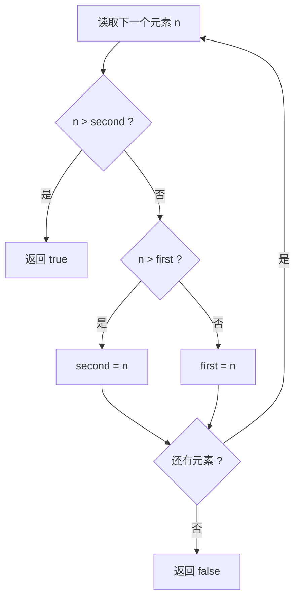

# 递增的三元子序列：解法分析笔记

> 题源：[LeetCode 334 - Increasing Triplet Subsequence](https://leetcode.cn/problems/increasing-triplet-subsequence/description/)
>
> 实现：<https://github.com/delight-rs/rust-algorithm/blob/main/src/arrary/increasing_triplet_subsequence.rs>
>
> 一句话概括：用 `first` 维护已遍历部分的最小值、`second` 维护所有递增对第二个元素的最小值，一次扫描即可判断是否存在长度 3 的递增子序列，时间 O(n)，额外空间 O(1)。

## 1. 输入与输出

### 1.1 输入

| 项     | 内容                                                                           |
| ------ | ------------------------------------------------------------------------------ |
| 参数   | `nums: Vec<i32>`，按值传入，函数内部通过 `for n in nums` 消费                  |
| 长度   | 题面约束 `1 <= nums.len() <= 5 * 10^5`；代码对空数组也返回 `false`，不会 panic |
| 元素   | `-2^31 <= nums[i] <= 2^31 - 1`，可正、可负、可重复；**不要求有序**             |
| 特殊值 | 允许 `i32::MIN` 与 `i32::MAX`；允许全部元素相同；允许只有一个或两个元素        |

### 1.2 输出

返回 `bool`：

```text
true  ⇔ 存在下标 i < j < k，使得 nums[i] < nums[j] < nums[k]
false ⇔ 不存在这样的三个下标
```

需要注意三点：

- 「子序列」只要求**下标递增**，不要求三个元素在数组中连续；
- 比较是**严格递增**，`nums[i] == nums[j]` 不算；
- `i`、`j`、`k` 必须是三个不同的下标。

### 1.3 示例

| 输入 `nums`                | 输出    | 说明                                                   |
| -------------------------- | ------- | ------------------------------------------------------ |
| `[1, 2, 3, 4, 5]`          | `true`  | 整体递增，任意三个下标都满足                           |
| `[5, 4, 3, 2, 1]`          | `false` | 严格递减，不存在递增对，更不存在三元组                 |
| `[2, 1, 5, 0, 4, 6]`       | `true`  | 下标 `(1, 4, 5)` 对应 `1 < 4 < 6`                      |
| `[2, 2, 3]`                | `false` | 前两个元素相等，严格递增不成立                         |
| `[20, 100, 10, 12, 5, 13]` | `true`  | 下标 `(2, 3, 5)` 对应 `10 < 12 < 13`；途中出现过更小值 |

### 1.4 边界与约束

- 题面保证：`1 <= n <= 5 * 10^5`，元素在 `i32` 范围内。
- 代码自己处理：`n = 0`、`n = 1`、`n = 2` 时循环自然结束并返回 `false`，不需要额外特判。
- 代码隐含假设：输入是合法的 `Vec<i32>`；全程只做比较、不做算术，因此不存在整型溢出问题。
- 哨兵细节：`first` 和 `second` 都初始化为 `i32::MAX`，并且第一个分支用的是严格比较 `n > second`。如果误写成 `n >= second`，输入 `[i32::MAX]` 会在第一步就错误返回 `true`。

## 2. 文件中的两个实现

### 2.1 `increasing_triplet_2`：三重循环暴力

```rust
for i in 0..nums.len() {
    for j in i + 1..nums.len() {
        if nums[i] < nums[j] {
            for k in j + 1..nums.len() {
                if nums[j] < nums[k] {
                    return true;
                }
            }
        }
    }
}
```

- **思路**：直接按定义枚举所有 `i < j < k`，找到第一组严格递增的三元组就返回。
- **时间**：最坏 O(n³)。注意最坏情况不是「整体递增」（那种输入在 `i = 0, j = 1, k = 2` 时立刻返回），而是存在大量递增对却始终凑不出三元组的输入，例如 `[1, 2, 1, 2, 1, 2, …]`：每一对 `(1, 2)` 都会进入内层循环，但找不到大于 2 的第三个元素。
- **空间**：O(1)。
- **局限**：`n = 5 * 10^5` 时最坏约 `1.25 * 10^17` 次内层判断，完全不可用。它的价值是作为小数据对拍的正确性基准。

### 2.2 `increasing_triplet`：一次扫描的贪心（最优解）

先给两个变量一个准确的含义（先不要被名字误导）：

| 变量     | 不变式含义                                                                                              |
| -------- | ------------------------------------------------------------------------------------------------------- |
| `first`  | 已遍历元素中的**最小值**                                                                                |
| `second` | 所有「在它之前存在更小元素」的已遍历元素中的**最小值**，也就是长度为 2 的递增子序列最后一个元素的最小值 |

遍历每个元素 `n`，三个分支恰好覆盖全部情况：

| 条件                  | 含义                                                    | 操作                    |
| --------------------- | ------------------------------------------------------- | ----------------------- |
| `n > second`          | `second` 背后存在一个真实递增对，且其第二个元素小于 `n` | 找到三元组，返回 `true` |
| `first < n <= second` | `n` 可以接在当前最小值后面，成为一个更优的第二个元素    | `second = n`            |
| `n <= first`          | `n` 比之前所有元素都小，不可能作为第二个元素            | `first = n`             |

用流程图表示：



代码本身：

```rust
let mut first = i32::MAX;
let mut second = i32::MAX;

for n in nums {
    if n > second {
        return true;
    } else if n > first {
        second = n;
    } else {
        first = n;
    }
}

false
```

### 2.3 状态追踪

以题目示例 3 的 `[2, 1, 5, 0, 4, 6]` 为例：

| 步骤 | `n` | `n > second` | `n > first` | 更新后 `first` | 更新后 `second` | 说明                                   |
| ---- | --- | ------------ | ----------- | -------------- | --------------- | -------------------------------------- |
| 初始 | —   | —            | —           | `MAX`          | `MAX`           | 还没有元素                             |
| 1    | 2   | 否           | 否          | 2              | `MAX`           | 2 成为当前最小值                       |
| 2    | 1   | 否           | 否          | 1              | `MAX`           | 1 成为当前最小值                       |
| 3    | 5   | 否           | 是          | 1              | 5               | 递增对 `(1, 5)` 建立                   |
| 4    | 0   | 否           | 否          | 0              | 5               | 0 成为最小值；`second` 仍来自 `(1, 5)` |
| 5    | 4   | 否           | 是          | 0              | 4               | 递增对 `(0, 4)` 比 `(1, 5)` 更优       |
| 6    | 6   | 是           | —           | 0              | 4               | `6 > 4`，返回 `true`                   |

第 4 步值得注意：`first` 已经变成 0，但 `second = 5` 仍然来自更早的递增对 `(1, 5)`。**`first` 与 `second` 并不一定来自同一对元素**，当前 `first` 的下标甚至可能晚于 `second` 所对应第二个元素的下标。算法只关心「存在某个更早的更小元素」，不需要把两者绑定。

再看一个全递减的例子 `[5, 4, 3, 2, 1]`：每个元素都满足 `n <= first`，于是 `first` 一路变小，`second` 始终是 `MAX`，循环结束返回 `false`。

### 2.4 正确性说明

**循环不变量**（每轮迭代结束时成立）：

1. `first` 等于已遍历元素的最小值。
2. 若已遍历部分存在递增对 `(i, j)`，则 `second` 等于所有这样的 `nums[j]` 中的最小值，并且 `second` 一定对应某个真实的递增对；若不存在递增对，则 `second = i32::MAX`。
3. 只要曾经出现三元组，函数已经提前返回（不会再继续循环）。

**逐分支验证不变量**：

- `n > second`：由不变量 2，`second` 背后存在递增对 `(i, j)`，且 `nums[i] < nums[j] = second < n`，三个下标依次递增，三元组成立，返回 `true` 正确。
- `first < n <= second`：`first` 对应的下标在当前元素之前，且 `first < n`，所以 `n` 可以作为一个新的第二个元素；又因为 `n <= second`，用 `n` 替换 `second` 得到的就是更小的第二个元素，不变量 2 保持。
- `n <= first`：之前所有元素都不小于 `n`，不存在更小元素在 `n` 之前，所以 `n` 不能作为第二个元素，`second` 不变；同时 `n` 成为新的最小值，不变量 1 保持。

**完备性**：如果数组中存在某个三元组 `(i, j, k)`，那么处理到 `nums[k]` 时，递增对 `(i, j)` 已经被处理过。由不变量 2，`second <= nums[j] < nums[k]`，第一个分支必然触发并返回 `true`。因此循环正常结束就一定不存在三元组。

**易错点**：

1. **分支顺序不能交换**。如果先判断 `n > first` 再判断 `n > second`，遇到 `[1, 2, 10, 11]` 时，10 会先把 `second` 从 2 覆盖成 10，随后 11 只会继续覆盖，最终错误返回 `false`。先判断 `n > second` 是为了在「能立刻完成三元组」时优先生效。
2. **`second = n` 不需要再取 min**。因为前面的 `n > second` 分支已经排除了 `n > second` 的情况，走到这里必然有 `n <= second`，直接赋值就是取最小值。
3. **`first` 与 `second` 不一定来自同一对元素**。`second` 只保证存在某个更早的递增对，当前的 `first` 下标可能晚于该对第二个元素的下标；如果题目要求输出具体下标，必须为 `second` 单独记录来源递增对。
4. **哨兵依赖严格比较**。`i32::MAX` 不可能被任何元素严格大于，因此哨兵不会被误判为真实的第二个元素。

## 3. 为什么能想到这个方案

### 3.1 最直白的解法

题目定义本身就是「枚举三个下标并比较」，所以第一反应是三重循环，时间 O(n³)，空间 O(1)。它没有任何预处理，重复比较极多，只能用于理解定义和小数据对拍。

### 3.2 第一次优化：固定中间元素

暴力法的主要浪费在于：对每个三元组都重新比较。换一个视角，固定中间下标 `j`，问题变成：

```text
存在 i < j 使 nums[i] < nums[j]，且存在 k > j 使 nums[k] > nums[j]
```

而「左侧是否有更小元素」只需要左侧最小值，「右侧是否有更大元素」只需要右侧最大值：

```text
min_left[j]  = min(nums[0..=j])
max_right[j] = max(nums[j..n-1])

答案 = 存在 j，使 min_left[j] < nums[j] < max_right[j]
```

预计算两个数组后，一次线性扫描即可判定，时间 O(n)，额外空间 O(n)。这是正确且直观的 O(n) 方案，但还不是最优空间。

### 3.3 为什么不能只维护「最小值和最大值」

一个很自然的压缩想法是：边扫边记录见过的最小值和最大值，只要 `min < max` 就说明有递增趋势。但这不够，因为**顺序信息丢失了**。例如 `[5, 1, 4]`：

- 最小值是 1，最大值是 5，看似存在 `1 < 5`；
- 但 5 出现在 1 之前，无法作为递增对的第一个元素，数组里实际上只有 `1 < 4` 这一对，构不成三元组。

所以状态里必须区分「最小值」和「能够作为第二个元素的值」，这就是 `second` 存在的原因。

### 3.4 关键转折：只保留「第二元素的最小值」

假设已经处理过的部分里存在若干递增对，对于未来的元素 `x`，我们只关心一件事：**是否存在一个递增对，其第二个元素小于 `x`**。在所有递增对中，第二个元素最小的那一个最容易被后续元素接上；如果它都接不上，其他递增对更接不上。因此只需要维护：

```text
second = min{ nums[j] : 存在 i < j 且 nums[i] < nums[j]，i、j 均已遍历 }
```

这个量可以边扫边更新：

- 新元素 `x` 若大于 `second`，直接完成三元组；
- 若 `first < x <= second`，则 `(first, x)` 是新的递增对，且 `x` 比当前 `second` 更小，更新 `second`；
- 若 `x <= first`，它不是任何已遍历元素的「更大后继」，不能作为第二个元素，但它刷新了最小值，更新 `first`。

这就是贪心交换论证：**保留最小的第二个元素不会丢掉任何未来机会**。任何能被其他递增对接上的未来元素，也一定能被最小 `second` 接上。

另一个等价视角是**耐心排序（patience sorting）求最长递增子序列（LIS）**：维护每个长度的递增子序列最后一个元素的最小值。长度为 1 的最小值就是 `first`，长度为 2 的最小值就是 `second`；一旦新元素大于长度为 2 的最小值，LIS 长度至少为 3。由于目标长度固定为 3，数组退化成两个变量，时间 O(n)、空间 O(1)。

### 3.5 空间优化

从「前缀最小值数组 + 后缀最大值数组」的 O(n) 空间，压缩到两个滚动变量，原因有两点：

- 判定只要求「存在性」，不需要保存每个位置的结果；
- 正序扫描时，右侧还没处理，但可以用「已经建立的递增对」代替「右侧最大值」这一信息。

如果题目要求返回具体下标，仍然只需要 O(1) 额外空间，但必须额外记录 `second` 来源递增对的两个下标。不能直接用当前的 `first` 下标：如 2.3 所示，`first` 可能晚于 `second` 对应的第二个元素，两者拼不出合法顺序。

### 3.6 可迁移的模板

> 判断是否存在长度为 `k` 的递增子序列时，维护长度为 `1 .. k-1` 的递增子序列「最后一个元素的最小值」。新元素大于长度为 `k-1` 的最小值时答案为真；否则用它更新对应长度的最小值。`k = 3` 时就是两个变量。

| 同类问题           | 维护的状态                 | 时间       | 空间 |
| ------------------ | -------------------------- | ---------- | ---- |
| LIS 长度           | `tails` 数组 + 二分插入    | O(n log n) | O(n) |
| 递增三元组（本题） | `first`、`second` 两个标量 | O(n)       | O(1) |
| 132 模式           | 从右向左的最大值 + 单调栈  | O(n)       | O(n) |
| 连续递增三元组     | 相邻三元素比较             | O(n)       | O(1) |
| 递减三元组         | 把比较方向反转             | O(n)       | O(1) |

## 4. 复杂度对比

| 实现                        | 时间                           | 额外空间 | 前提/限制                        |
| --------------------------- | ------------------------------ | -------- | -------------------------------- |
| `increasing_triplet_2`      | 最坏 O(n³)，无递增对时 O(n²)   | O(1)     | 仅适合小数据与对拍               |
| `increasing_triplet`        | O(n)，命中时可能 O(1) 提前返回 | O(1)     | 只能判断存在性，不能直接返回下标 |
| 前缀最小数组 + 后缀最大数组 | O(n)                           | O(n)     | 思路直观，需要两遍扫描或额外数组 |

补充说明：

- `increasing_triplet` 每个元素最多做两次比较，最坏 `2n` 次；没有任何分配，缓存友好。
- 时间下界是 Ω(n)：最坏情况下（例如严格递减）必须读完所有元素才能确定答案。
- 输出是 `bool`，不计入额外空间；输入按值传入并被消费，额外内存不随 `n` 增长。
- 该扫描存在严格的前后依赖，不能直接分块并行；若强行分块，需要把每块的 `(first, second, 是否已找到)` 作为摘要合并，收益通常不值得。
- 暴力版在 `n = 5 * 10^5` 时最坏约 `1.25 * 10^17` 次判断，而 O(n) 版只有约 `10^6` 次比较，差距是能否在时限内完成的区别。

## 5. 实际应用场景

「在一段按时间排列的数据里，是否存在三个依次抬高的值」是流式监控中的常见判定。

| 场景             | 被检查的模式                                            | 为什么用该方案而不是更简单的方案                                             |
| ---------------- | ------------------------------------------------------- | ---------------------------------------------------------------------------- |
| 监控与可观测性   | 延迟、错误率等指标按时间出现三次抬高（允许中间有回落）  | 只需两个标量和一次扫描，可嵌入流式管道；「连续三次」会漏掉中间回落的真实趋势 |
| 金融行情         | 收盘价、成交量出现时间顺序上的 higher highs             | 不必保存历史窗口，O(1) 状态适合实时行情流；只判断存在性，开销极低            |
| 风控与反欺诈     | 同一账户的交易金额或登录频率按时间出现三次递增          | 事件流无界，O(1) 状态可常驻内存；命中后再回溯明细                            |
| 数据库与日志分析 | 按时间排序后检查某字段是否形成三级递增                  | 单遍扫描即可完成，避免自连接带来的 O(n³) 代价                                |
| 排序质量检查     | 判断一个序列是否存在长度 3 的递增链（LIS 是否至少为 3） | 比完整 LIS 的 O(n log n) 更轻，且不需要额外数组                              |
| 传感器与生物信号 | 三次阈值穿越按时间递增                                  | 嵌入式设备内存受限，O(1) 额外状态非常合适                                    |

工程注意：

- **严格递增的语义**：重复值不算递增；浮点数据中的 `NaN` 与任何值比较都为 `false`，会破坏判断，应先清洗。
- **只要存在性还是要定位**：线上告警通常还要给出具体时间点，此时需要为 `second` 记录来源递增对的下标，仍是 O(1)，但不能用当前 `first` 的下标去拼。
- **流式与乱序**：算法要求按时间顺序输入；乱序事件需要先排序或按窗口处理。
- **“连续”与“子序列”不同**：如果业务要求三个**相邻**采样点递增，直接比较相邻元素即可，不要使用本算法，否则会放宽条件。
- **更大的 `k`**：`k` 较大时用耐心排序维护 `k-1` 个最小值（O(n log k)），而不是写 `k-1` 个分支。

## 6. 延伸与变体

| 变体                  | 做法                                                         | 关键点                                              |
| --------------------- | ------------------------------------------------------------ | --------------------------------------------------- |
| 长度为 k 的递增子序列 | 维护 `k-1` 个「对应长度的最小最后元素」，二分更新            | `k = 3` 时退化为本题；`tails` 数组天然有序          |
| 递减三元组            | 把 `<` 与 `>` 全部反转，或先把元素取负                       | 严格性要同步反转                                    |
| 非递减三元组          | 按业务定义把严格比较改成 `<=` / `>=`，并重新检查哨兵         | 重复值会改变答案                                    |
| 返回具体下标          | 为 `second` 记录其来源递增对的两个下标                       | 不能用当前 `first` 的下标，它可能晚于 `second` 来源 |
| 统计递增三元组个数    | 固定中间元素，统计左侧更小个数与右侧更大个数，用树状数组维护 | O(n log n)，与「判断存在性」是不同问题              |
| 连续递增三元组        | 一次遍历比较 `nums[i]`、`nums[i+1]`、`nums[i+2]`             | O(n)，不需要贪心状态                                |
| 132 模式              | 从右向左扫描，维护「可作为第三元素的最大值」与单调栈         | 顺序约束不同，但同样是「两个候选状态」的思路        |
| 动态数组 + 区间查询   | 线段树节点维护最小值、最大值以及是否存在递增对/三元组        | 合并节点时要处理跨左右区间的组合，比静态扫描复杂    |

## 7. 现有测试覆盖评价

`src/arrary/increasing_triplet_subsequence.rs` 中的 13 个测试全部通过，已覆盖：

- 题目给出的三个示例；
- 长度不足：单元素、两个元素；
- 全部相等、重复值破坏严格递增；
- 全负数、负数与 0 混合；
- `i32::MIN`、`i32::MAX` 参与的三元组；
- 下标不相邻的递增三元组；
- 中途出现更小值、后段才形成答案的输入；
- `n = 500_000` 的严格递减数组（时间与内存的压力冒烟）。

可以补强的地方：

1. **随机对拍**：以 `increasing_triplet_2` 为基准，生成小长度、小值域的随机数组，断言两个实现结果一致。这能覆盖手写样例难以枚举的分支组合，也能顺便验证暴力版本身是否正确。
2. **固定哨兵与严格性**：`[i32::MAX; 3]`、`[i32::MIN, i32::MIN, i32::MAX]`、`[i32::MIN, i32::MAX, i32::MAX]` 都应返回 `false`，可以防止有人把比较改成 `>=`。
3. **`second` 先建立、`first` 后刷新**：如 `[1, 2, 0, 3]`、`[5, 6, 1, 7]`，用于固定「两个变量不来自同一对元素」这一容易误解的行为。
4. **空数组**：题面约束之外，但代码当前返回 `false`，可以补一个测试固定该行为。
5. **暴力版测试**：目前所有测试只调用 `increasing_triplet`，`increasing_triplet_2` 没有任何直接断言。若把它作为对拍基准，至少应先保证基准自身正确。

## 8. 小结

| 维度      | 结论                                                                             |
| --------- | -------------------------------------------------------------------------------- |
| 输入      | `Vec<i32>`，长度至多 `5 * 10^5`，元素可正可负可重复，不要求有序                  |
| 输出      | `bool`，表示是否存在下标递增且值严格递增的三元组                                 |
| 最优解    | 一次扫描，维护已遍历部分的最小值与所有递增对第二个元素的最小值                   |
| 时间/空间 | O(n) / O(1) 额外空间                                                             |
| 关键思想  | 只保留「最容易被后续元素接上的递增对」，即第二个元素最小的递增对                 |
| 易错点    | 分支顺序不能交换；严格比较与 `i32::MAX` 哨兵；`first` 与 `second` 不必来自同一对 |
