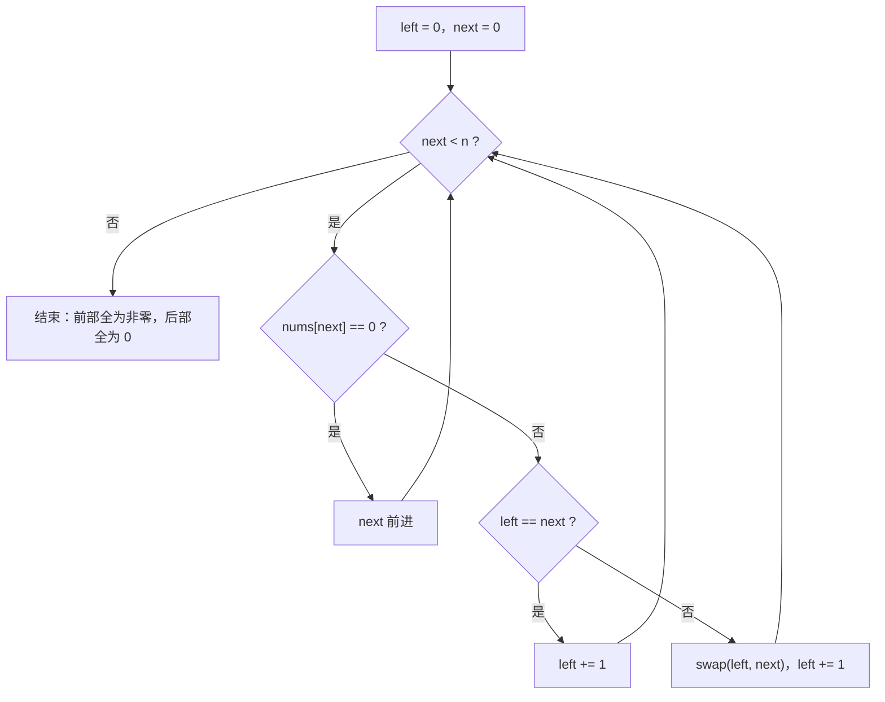

# 移动零：解法分析笔记

> 题源：[LeetCode 283 - Move Zeroes（中文站）](https://leetcode.cn/problems/move-zeroes/description/?envType=problem-list-v2&envId=xulyhlrg) / [英文站](https://leetcode.com/problems/move-zeroes/description/?envType=study-plan-v2&envId=leetcode-75)
>
> 实现：<https://github.com/delight-rs/rust-algorithm/blob/main/src/arrary/move_zeroes.rs>
>
> 一句话概括：用一个写指针维护「已就位的非零前缀」、读指针顺序扫描，原地完成稳定压缩，时间 O(n)、额外空间 O(1)；交换版按需交换，覆盖版每个位置写一次再整体补零。

## 1. 输入与输出

### 1.1 输入

| 项       | 内容                                                         |
| -------- | ------------------------------------------------------------ |
| 参数     | `nums: &mut Vec<i32>`，原地修改，长度不变；两个实现签名相同  |
| 长度     | 题目约束 `1 <= nums.len() <= 10^4`；代码对空数组也不会 panic |
| 元素     | `-2^31 <= nums[i] <= 2^31 - 1`，可正、可负、可重复，允许 0   |
| 顺序     | 输入不要求有序；输出要求非零元素之间的相对顺序与输入一致     |
| 特殊值   | 允许全 0、没有 0、只有一个元素、`i32::MIN` / `i32::MAX`      |
| 内存约束 | 必须原地修改，不能返回新数组；额外空间应为 O(1)              |

### 1.2 输出

返回类型是 `()`，结果直接写回参数 `nums`：

```text
设 m = 原数组中非零元素的个数，a0, a1, ..., a_{m-1} 是它们按原顺序的取值
修改后：nums[i] = a_i   （0 <= i < m）
        nums[i] = 0     （m <= i < n）
数组长度 n 保持不变
```

两点说明：

- 输出就是被修改的输入本身，**不计入额外空间**；算法只使用若干下标变量。
- 「相对顺序」指非零元素之间的顺序，例如 `[2, 0, 1]` 中的 `2` 必须仍然排在 `1` 前面，不能变成 `[1, 2, 0]`。

### 1.3 示例

| 输入 `nums`                             | 输出                                    | 说明                         |
| --------------------------------------- | --------------------------------------- | ---------------------------- |
| `[0, 1, 0, 3, 12]`                      | `[1, 3, 12, 0, 0]`                      | 题目示例 1：0 与非零交替出现 |
| `[0]`                                   | `[0]`                                   | 题目示例 2：单元素且为 0     |
| `[1, 2, 0, 3, 12]`                      | `[1, 2, 3, 12, 0]`                      | 仓库测试：只有一个 0         |
| `[0, 0, 0, 0, 0]`                       | `[0, 0, 0, 0, 0]`                       | 全 0，结果不变               |
| `[5, -2, 7, 7]`                         | `[5, -2, 7, 7]`                         | 没有 0，顺序原样保留         |
| `[i32::MIN, 0, -1, 0, -1, i32::MAX, 0]` | `[i32::MIN, -1, -1, i32::MAX, 0, 0, 0]` | 极值、负数、重复值           |

### 1.4 边界与约束

- 题目保证：`1 <= n <= 10^4`，元素在 `i32` 范围内，结果为原地修改。
- 代码自己处理：`n = 0`、`n = 1` 时循环自然不执行或只执行一次，不会越界；空数组属于题目约束之外，但当前实现返回空数组。
- 代码隐含假设：只区分「等于 0」与「不等于 0」，全程只做比较和交换/赋值，**没有算术运算**，因此不存在整型溢出问题。
- 与「删除元素」类题目的区别：这里不能缩短数组，必须保留 `n` 个位置，并把 0 填满后部分。

## 2. 文件中的两个实现

### 2.1 `move_zeroes`：交换版双指针

```rust
pub fn move_zeroes(nums: &mut Vec<i32>) {
    let mut left: usize = 0;

    for next in 0..nums.len() {
        if nums[next] != 0 {
            if left != next {
                nums.swap(left, next);
            }

            left += 1
        }
    }
}
```

**核心思想**：把 `nums[0..left]` 视为「已经就位的非零前缀」，`left` 是下一个非零元素应该放的位置；`next` 从左到右读取每个元素。

处理规则：

1. `nums[next] == 0`：不处理，`next` 继续前进。
2. `nums[next] != 0` 且 `left == next`：当前位置本来就是正确的，直接把 `left` 前移。
3. `nums[next] != 0` 且 `left < next`：由于 `[left, next)` 区间里只可能是 0，`nums[left]` 一定是 0。交换后非零元素落到 `left`，0 被换到 `next`，然后把 `left` 前移。



图中省略了 `for` 循环每轮结束时 `next` 自动加 1 的细节。

- **时间**：一次扫描，`n` 次比较，O(n)。
- **空间**：只有两个下标，O(1)。
- **写次数**：交换一次等于两次元素写入，总写入次数为 `2 × 交换次数`；没有 0 出现在非零元素前面时，交换次数为 0。
- **优势**：不需要额外临时数组，也不要求元素可以复制，`swap` 只移动元素，适合元素体积较大的场景。
- **局限**：如果数组开头连续出现 0、后面全是非零元素，几乎每个非零元素都要交换一次，写次数接近 `2n`。

### 2.2 `move_zeroes_2`：覆盖写 + 补零

```rust
pub fn move_zeroes_2(nums: &mut Vec<i32>) {
    let length = nums.len();
    let mut left = 0;

    for i in 0..length {
        let n = nums[i];
        if n != 0 {
            nums[left] = n;
            left += 1;
        }
    }

    for i in left..length {
        nums[i] = 0;
    }
}
```

**核心思想**：分两遍完成。第一遍只负责把非零元素「压缩」到前部，第二遍把剩余位置统一写成 0。

关键细节：

- `let n = nums[i];` 先把当前值读入局部变量，再写 `nums[left]`。因为始终有 `left <= i`，写入位置不会超过当前读位置，未读取的元素（下标大于 `i`）不会被覆盖。
- 第一遍结束后，`[0, left)` 是保持原序的非零元素，`[left, length)` 是**旧数据残留**，可能是非零值，不一定是 0。例如 `[0, 1, 0, 3, 12]` 第一遍后会变成 `[1, 3, 12, 3, 12]`。
- 第二遍把 `[left, length)` 全部置 0，才得到最终结果。

- **时间**：两遍扫描，O(n)。
- **空间**：O(1)。
- **写次数**：第一遍每个非零元素写一次（包括 `left == i` 时的自赋值），第二遍写 `n - left` 个 0，总计恰好 `n` 次写入。
- **优势**：每个位置最多写一次，是 LeetCode 追问「尽量减少操作次数」时常用的方案；代码中不存在交换的临时变量。
- **局限**：第二遍不能省略；对非 `Copy` 类型需要 `Clone` 或改成 `swap` 方式；当输入几乎没有 0 时，第一遍仍然执行 `n` 次写入，比交换版多。

### 2.3 状态追踪

以 `nums = [0, 1, 0, 3, 12]` 为例。

`move_zeroes`（交换版）：

| `next` | `nums[next]` | 交换前 `left` | 操作                        | 数组状态           |
| ------ | ------------ | ------------- | --------------------------- | ------------------ |
| 0      | 0            | 0             | 跳过                        | `[0, 1, 0, 3, 12]` |
| 1      | 1            | 0             | 交换下标 0 与 1，`left = 1` | `[1, 0, 0, 3, 12]` |
| 2      | 0            | 1             | 跳过                        | `[1, 0, 0, 3, 12]` |
| 3      | 3            | 1             | 交换下标 1 与 3，`left = 2` | `[1, 3, 0, 0, 12]` |
| 4      | 12           | 2             | 交换下标 2 与 4，`left = 3` | `[1, 3, 12, 0, 0]` |

`move_zeroes_2`（覆盖写版）：

| `i`  | `nums[i]` | 写入前 `left` | 操作                       | 数组状态            |
| ---- | --------- | ------------- | -------------------------- | ------------------- |
| 0    | 0         | 0             | 跳过                       | `[0, 1, 0, 3, 12]`  |
| 1    | 1         | 0             | `nums[0] = 1`，`left = 1`  | `[1, 1, 0, 3, 12]`  |
| 2    | 0         | 1             | 跳过                       | `[1, 1, 0, 3, 12]`  |
| 3    | 3         | 1             | `nums[1] = 3`，`left = 2`  | `[1, 3, 0, 3, 12]`  |
| 4    | 12        | 2             | `nums[2] = 12`，`left = 3` | `[1, 3, 12, 3, 12]` |
| 补零 | —         | 3             | 把下标 3、4 置 0           | `[1, 3, 12, 0, 0]`  |

两张表的结果都与测试期望一致。

### 2.4 正确性说明

**交换版的循环不变量**：每轮循环开始时（`next = k`），

```text
nums[0..left]  恰好是原数组 nums[0..k] 中的全部非零元素，且保持原有相对顺序
nums[left..k]  全部为 0
left <= k
```

- 遇到 0：不变量直接扩展到 `k + 1`。
- 遇到非零且 `left == k`：把它接到非零前缀的末尾，`left` 与 `next` 同步前移。
- 遇到非零且 `left < k`：`nums[left]` 必为 0，交换后非零元素被追加到前缀末尾，0 留在 `k`，零区间扩大一位。
- 循环结束时 `k = n`，所以 `[0, left)` 是全部非零元素，`[left, n)` 全是 0，满足输出定义。非零元素是按扫描顺序追加的，因此相对顺序不变。

**覆盖写版的循环不变量**：第一遍扫描到 `i` 时，

```text
nums[0..left]  恰好是原数组 nums[0..i] 中的全部非零元素，且保持原有相对顺序
left <= i
nums[i..n]     尚未被读取，也没有被写入
```

- 读取 `nums[i]` 存入局部变量，再写入 `nums[left]`；由于 `left <= i`，写入不会破坏还没读到的元素。
- 第一遍结束时得到稳定压缩后的非零前缀；第二遍把长度补齐为 `n` 的 0，得到最终结果。

**易错点**：

1. **忘记补零**：`move_zeroes_2` 第一遍结束后后部分仍是旧数据，例如 `[1, 3, 12, 3, 12]`，必须执行第二遍。
2. **先写后读**：覆盖写版本必须先读取当前元素；如果先从 `left` 处写入、再读 `i`，在 `left == i` 附近会丢失数据。当前代码用局部变量 `n` 规避了这一点。
3. **`left += 1` 的位置**：交换版中它必须在 `if nums[next] != 0` 内、且在 `if left != next` 外，保证「不交换但也要前移」。
4. **`left != next` 只是优化**：即使自交换也不会改变结果，但会多出两次无意义的写入。
5. **两个指针的单调性**：`left` 和 `next` 都只增不减，`left <= next` 始终成立；这是不越界、不覆盖未读数据的前提。

## 3. 为什么能想到这个方案

### 3.1 最直白的解法

- **新建数组**：先遍历一遍把非零元素按顺序放进新数组，再把剩余位置补 0，最后拷贝回去。时间 O(n)，但需要 O(n) 额外空间，违反「原地修改」的要求。
- **逐个删除 0**：每找到一个 0，就把它后面的所有元素左移一位，再在末尾补 0。`Vec::remove` 单次就是 O(n)，最坏有 O(n) 个 0，总时间 O(n²)。例如输入 `[0, 0, ..., 0, 1]` 时，每次删除都要搬动整个后部分。

瓶颈在于：每遇到一个 0 都要成批移动它后面的元素，而这些元素之间的相对顺序本来就正确，移动属于重复劳动。

### 3.2 优化尝试及失败原因

**尝试 1：从两端向中间交换。** 左指针找 0、右指针找非零，然后交换。这是快速排序 `partition` 的常见写法，一次扫描就能把非零元素放到左侧，但它**不稳定**。以 `[0, 1, 2, 0]` 为例：

```text
左指针找到下标 0 的 0，右指针找到下标 2 的 2
交换后：[2, 1, 0, 0]
非零元素顺序从 1, 2 变成了 2, 1
```

失败的本质：一个非零元素的最终位置取决于「它前面有多少个非零元素」，而不是「右边还有多少个空位」。从两端交换只保证了「非零都在左边」，破坏了顺序信息。

**尝试 2：记录所有 0 的下标，再逐个删除。** 删除第 `i` 个 0 会让后面的下标整体前移，后续记录的下标全部失效，需要不断修正；即使修正正确，每次删除仍是 O(n)，总时间依旧是 O(n²)。失败的本质与 3.1 相同：逐个删除仍在重复搬动同一批元素。

**尝试 3：为每个 0 找到最近的后续非零元素并交换。** 如果每次都从数组开头重新搜索，最坏仍是 O(n²)；只要让搜索位置单调前进，就退化成 2.1 的 `left` / `next` 双指针。

### 3.3 换视角拆解

关键观察：**稳定输出中，第 k 个非零元素的最终下标就是 k**，与 0 的位置和数量无关。

```text
原数组非零元素（按出现顺序）：a0, a1, ..., a_{m-1}
最终位置：a0 -> 下标 0，a1 -> 下标 1，...，a_{m-1} -> 下标 m-1
剩余位置全部为 0
```

于是问题从「移动每个 0」变成「把每个非零元素写到它该去的位置」：

1. 维护 `left`，表示已经写入了多少个非零元素，也就是下一个非零元素的目标下标。
2. 顺序扫描，遇到非零就写到 `nums[left]`，然后 `left += 1`。
3. 扫描结束后，`left` 就是非零元素个数，后部分要么已经是 0（交换版），要么需要统一补 0（覆盖版）。

这个分解避开了 3.2 的失败原因：

- 每个元素只被处理常数次，不再成批左移；
- 写指针只增不减，扫描是线性的；
- 非零元素按读取顺序写入，天然保持相对顺序。

交换版和覆盖版的差别，本质上是「0 怎么处理」：

- 交换版把 0 换到当前读位置，扫描结束时数组已经完整，不需要第二遍；
- 覆盖版不动 0，让后部分暂时保留旧数据，最后统一补 0。这样每个位置只写一次，但必须多扫一遍。

### 3.4 空间优化

| 方案            | 额外空间 | 说明                                               |
| --------------- | -------- | -------------------------------------------------- |
| 新建数组        | O(n)     | 最直观，但违反原地要求                             |
| 交换版双指针    | O(1)     | 只需要 `left`、`next` 两个下标                     |
| 覆盖写 + 补零   | O(1)     | 只需要 `left` 和一个局部变量 `n`                   |
| `retain` + 补零 | O(1)     | 标准库内部同样是稳定压缩，容量不增长，但细节被封装 |

### 3.5 可迁移的模板

**稳定压缩模板**（stable compaction / stable partition）：

```text
write = 0
for read in 0..n:
    if keep(nums[read]):
        nums[write] = nums[read]
        write += 1

# 视题目要求决定是否需要把 [write, n) 填充为默认值
```

适用条件：需要保留被保留元素之间的相对顺序；判定条件可以写成一个谓词 `keep(x)`；允许原地覆盖写。

| 同类问题                         | 谓词 `keep(x)`         | 是否要求稳定   | 是否需要补默认值     |
| -------------------------------- | ---------------------- | -------------- | -------------------- |
| 283 移动零                       | `x != 0`               | 是             | 需要，后部分补 0     |
| 27 移除元素                      | `x != val`             | 否（但可保持） | 不需要，返回 `write` |
| 26 删除有序数组中的重复项        | 与前一个已写入元素不同 | 是             | 不需要               |
| 80 删除有序数组中的重复项 II     | 与前两个已写入元素不同 | 是             | 不需要               |
| 75 颜色分类                      | 按三种取值分区         | 否             | 不需要               |
| 905 按奇偶排序数组               | 按奇偶分区             | 否             | 不需要               |
| `Vec::retain` / `std::remove_if` | 任意谓词               | 是             | 由调用方决定         |

## 4. 复杂度对比

| 实现               | 时间       | 额外空间 | 写入次数                 | 前提/限制                                  |
| ------------------ | ---------- | -------- | ------------------------ | ------------------------------------------ |
| 逐个删除 0 并左移  | 最坏 O(n²) | O(1)     | O(n²)                    | 只作为对照，`Vec::remove` 每次都移动后部分 |
| 新建数组再拷贝回去 | O(n)       | O(n)     | n                        | 违反原地修改要求                           |
| `move_zeroes`      | O(n)       | O(1)     | `2 × 交换次数`，可以为 0 | 稳定；`swap` 不要求元素可复制，适合大对象  |
| `move_zeroes_2`    | O(n)，两遍 | O(1)     | 恰好 n                   | 稳定；需要读取元素值，第二遍必须补 0       |

补充说明：

- 输入是原地修改，没有输出数组，因此额外空间就是两个下标变量，均为 O(1)。
- 交换次数等于「位于第一个 0 之后的非零元素个数」。没有 0 时交换 0 次；0 全在末尾时也交换 0 次。
- 两种实现没有绝对的写次数优势：`[0, 1, 2, ..., n-1]` 这类「一个前导 0 + 其余全非零」的输入，交换版约 `2(n-1)` 次写入，覆盖版恰好 `n` 次；而「没有 0」的输入，交换版 0 次写入，覆盖版仍要写 `n` 次。若以「每个位置至多写一次」为衡量标准，覆盖版更优；若以实际写放大衡量，需要结合输入分布选择。
- 比较次数都是 `n`，只做整数比较，没有加法或乘法，因此不存在溢出问题。
- 扫描是顺序访问，缓存友好；覆盖版可以按块统计非零个数、做前缀和后再分块并行写入，交换版则依赖 `left` 的顺序推进，不容易直接并行。

## 5. 实际应用场景

「保留一部分元素、删除其余元素，同时保持顺序」是数据处理里最常见的原地操作之一。

| 场景                   | 被压缩的数据                | 为什么用该方案而不是更简单的方案                                                         |
| ---------------------- | --------------------------- | ---------------------------------------------------------------------------------------- |
| 垃圾回收的标记-压缩    | 存活对象与空闲槽位          | 存活对象向一端压缩可减少碎片；保持分配顺序有利于访问局部性，且不能分配等大的新空间       |
| 列式数据库与 LSM 压缩  | 存活行与删除标记（墓碑）    | 保持行序才能支持按序扫描；原地压缩避免整表复制                                           |
| 日志与 ETL 清洗        | 有效事件与空事件/被过滤事件 | 事件顺序具有业务含义；在固定缓冲区原地压缩可减少每条记录的分配                           |
| 稀疏向量与稀疏矩阵构建 | 非零值与零值                | 收集非零值是模板的第一遍；记录 `left` 即可得到非零个数，再补默认值                       |
| UI 列表与文本渲染      | 可见项与隐藏项              | 一次扫描更新可见项并保持显示顺序，避免反复删除导致的重排                                 |
| 标准库的删除接口       | 任意谓词命中的元素          | `Vec::retain`、C++ `std::remove_if` + `erase`、Go `slices.DeleteFunc` 都使用稳定压缩模板 |

工程注意：

- **谓词不一定是 `== 0`**：把 0 换成 `None`、空字符串、墓碑标记或任意 `is_valid` 判定，算法结构不变。对浮点数，`-0.0 == 0.0` 为真，`NaN != 0.0` 也为真，因此 `NaN` 会被当作非零值保留；如果业务语义不同，需要显式定义谓词。
- **写放大**：在闪存、持久化内存或写时复制页面上，写入次数是真实成本。此时应根据「0 的分布」选择交换版或覆盖版，而不是只看渐进复杂度。
- **元素体积**：元素是大结构体或 `String` 时，交换版只做移动；覆盖版需要复制或 `Clone`，成本更高。Rust 中可用 `std::mem::take` 配合 `swap` 避免克隆。
- **稳定性**：如果业务不要求顺序（例如只关心「非零都在左边」），可以用两端交换的分区写法；一旦顺序有含义（日志、时间序列、数据库行序），必须使用稳定压缩。
- **并行与分块**：覆盖版可以先把数组分块，统计每块保留的元素个数，做前缀和得到每块的写起点，再并行写入；交换版的状态依赖单个 `left`，难以直接并行。
- **流式数据**：如果数据无法一次装入内存，可以先输出保留元素流，最后由调用方补默认值，或者按块压缩并记录每块的保留数量。

## 6. 延伸与变体

| 变体                      | 做法                                                     | 关键点                                                    |
| ------------------------- | -------------------------------------------------------- | --------------------------------------------------------- |
| 27 移除元素               | 同一模板，谓词改为 `x != val`，返回 `left`               | 后部分内容不再重要，可以省掉补默认值                      |
| 26 删除有序数组中的重复项 | 谓词改为「与上一个已写入元素不同」                       | `write` 同时作为比较来源，注意读写位置重叠                |
| 80 删除重复项 II          | 谓词改为「与前两个已写入元素不同」                       | 需要保留最近两个已写入元素的信息                          |
| 把 0 移到前部             | 谓词改为 `x == 0`，后部分补非零值                        | 补值时默认值不再是 0，需要额外保存非零元素或改成分区      |
| 不稳定分区（75、905）     | 左右两个指针向中间扫描交换                               | 不保证相对顺序，代码更短，但不满足本题要求                |
| 泛型元素 `T`              | 用 `is_zero(&T)` 判定；覆盖版需要 `Clone` 或 `mem::take` | 交换版只移动不复制，更适合大对象                          |
| 分块与并行                | 每块统计保留数量，前缀和得到写起点，再并行写入           | 稳定且可并行，代价是需要两遍数据                          |
| `retain` + `resize`       | `nums.retain(\|&x\| x != 0); nums.resize(old_len, 0);`   | `old_len` 要在 `retain` 前保存；`retain` 不缩容，容量不变 |
| SIMD 压缩                 | 使用带 compress 语义的向量指令批量收集保留元素           | 需要硬件支持，适合大规模数值数组，但要处理尾部标量        |

## 7. 现有测试覆盖评价

`src/arrary/move_zeroes.rs` 中共有 14 个测试，全部通过，两个实现都有独立覆盖：

- 题目示例：`[0, 1, 0, 3, 12]`、`[0]`；
- 只有一个 0：`[1, 2, 0, 3, 12]`；
- 全 0、没有 0；
- 极值、负数与重复值混合：`i32::MIN`、`-1`、`i32::MAX`；
- 最大长度冒烟：`5000` 个 0 后接 `1..=5000`，总长度 `10000`，正好达到题目上限；
- 两个实现各自都有示例、全 0、无 0、极值、最大长度用例。

可以补强的地方：

1. **输入以 0 结尾但前面有非零元素**：例如 `[1, 2, 0]`、`[0, 1, 0]`，现有用例中只有单元素 `[0]` 和全 0 属于这一类，缺少「部分非零 + 末尾 0」的组合。
2. **单元素非零**：`[7]` 应保持不变，可以固定 `left == next` 的分支。
3. **稳定性的可区分用例**：`[3, 0, 1, 0, 2]` 应得到 `[3, 1, 2, 0, 0]`；重复值可以再用 `[2, 0, 1, 0, 2, 1]`，一旦实现退化成两端交换就会暴露。
4. **空数组**：题目约束之外，但当前实现返回空数组且不 panic，可以补测试固定该行为。
5. **随机对拍**：生成小长度、小值域的随机数组，同时调用两个实现，并与 `nums.iter().filter(|&&x| x != 0).chain(repeat(&0))` 构造的期望结果比较，能覆盖手写样例难以枚举的分支组合。
6. **自赋值路径**：`[5, -2, 7, 7]` 已经覆盖了 `left == i` 的情况，但可以再加一个「前导 0 后全为非零」的小例子，明确覆盖交换路径与 `2n` 写入附近的行为。

## 8. 小结

| 维度      | 结论                                                                   |
| --------- | ---------------------------------------------------------------------- |
| 输入      | `&mut Vec<i32>`，长度 `1..=10^4`，元素可正可负可重复，允许 0           |
| 输出      | 原地修改：非零元素保持原序放在前部，0 填满后部分，长度不变             |
| 最优解    | 双指针稳定压缩：`move_zeroes` 交换版、`move_zeroes_2` 覆盖写 + 补零    |
| 时间/空间 | 两者都是 O(n) / O(1)                                                   |
| 关键思想  | 第 k 个非零元素的最终下标就是 k，用写指针记录已就位非零元素的个数      |
| 易错点    | 忘记补零；`left += 1` 位置；用两端交换会破坏相对顺序；写指针超过读指针 |
